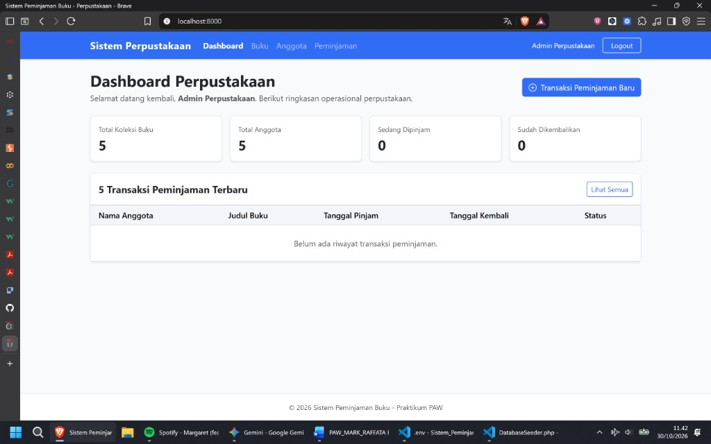
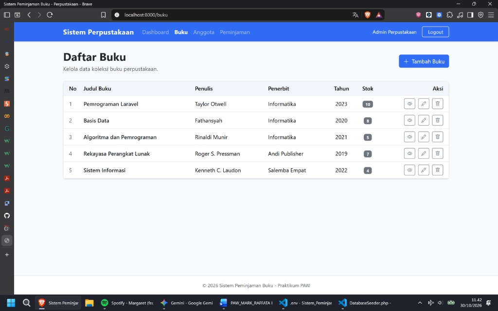
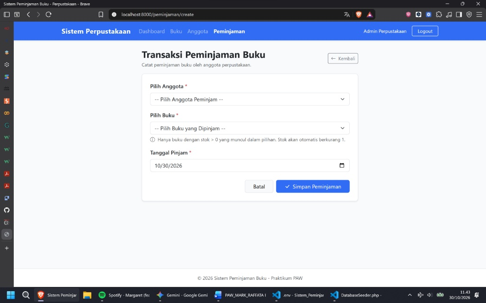
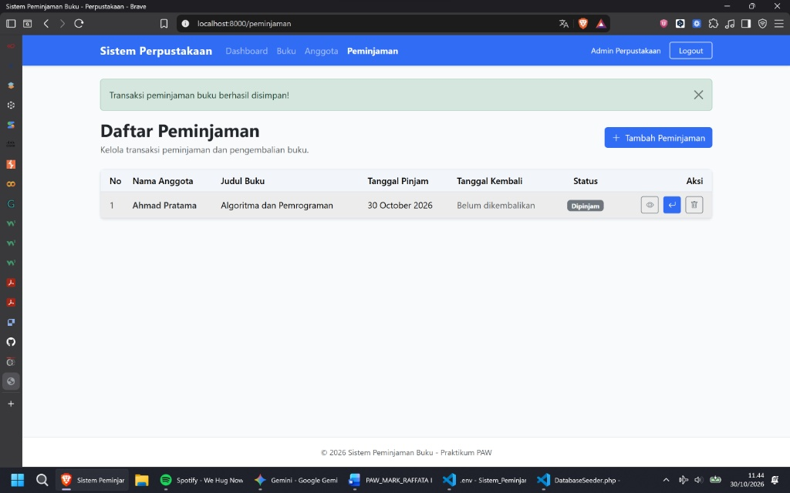
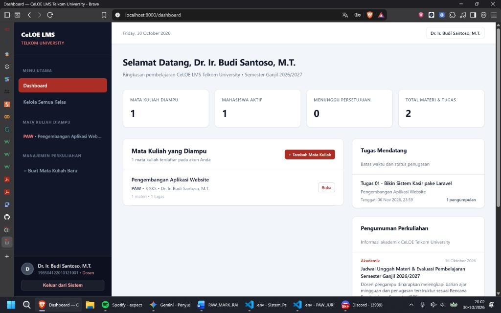
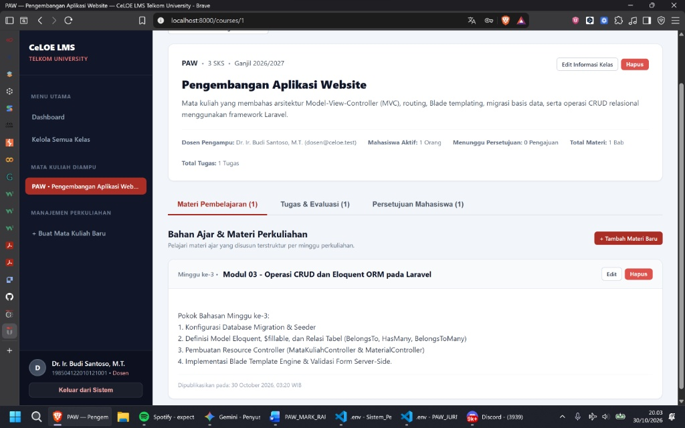
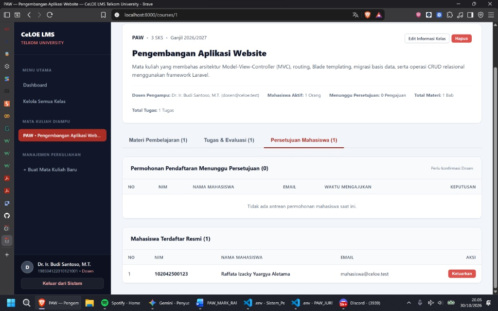
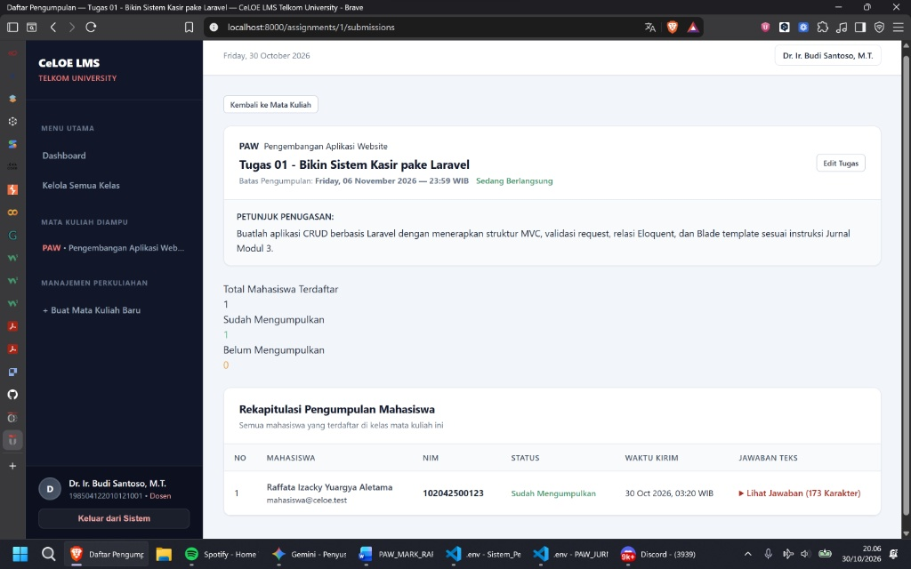
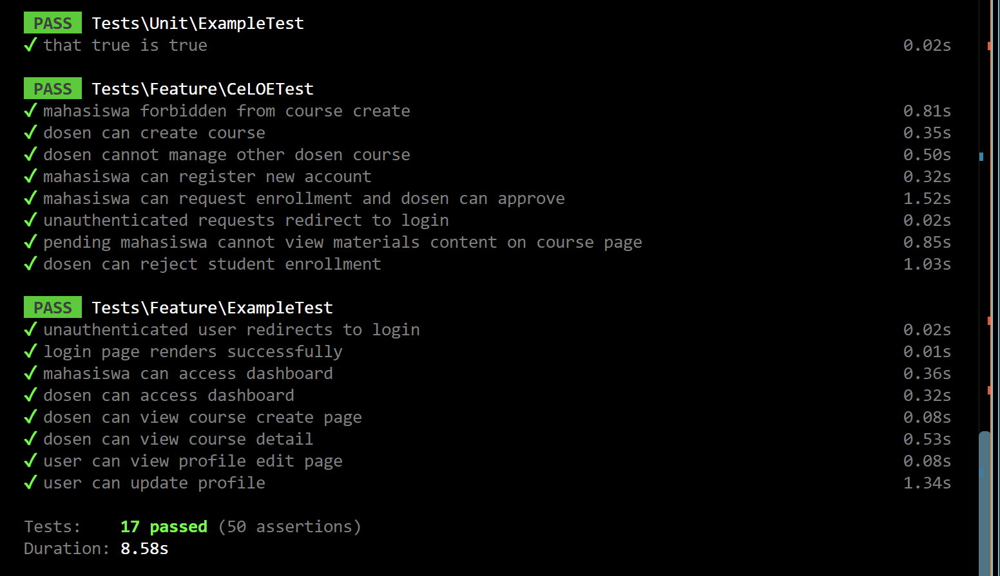

# PAW-MODUL3-RAFFATA-102042500123

Aplikasi web berbasis **Laravel 12 (Arsitektur MVC, Eloquent ORM, Database Migration & Seeder, serta Blade Template Engine)** untuk **Modul 3 (`Sistem Peminjaman Buku Perpustakaan`)** dan **Jurnal 3 (`CeLOE LMS — Learning Management System`)** pada mata kuliah Pengembangan Aplikasi Website (PAW) di Telkom University Jakarta.

[](https://www.php.net/)
[](https://laravel.com/)
[](https://www.mysql.com/)
[](https://getbootstrap.com/)
[](LICENSE)

## What This Does

Repositori ini mendokumentasikan dua proyek aplikasi web berbasis **Framework Laravel 12** dengan penerapan operasi **CRUD (Create, Read, Update, Delete)**, relasi **Eloquent ORM**, dan otorisasi berbasis peran (*Role-Based Access Control*):

1. **Modul 3 — `Sistem Peminjaman Buku Perpustakaan` (`PAW_MODUL3_RAFFATA_102042500123/`)**: Sistem manajemen perpustakaan untuk mengelola katalog buku, direktori anggota, serta sirkulasi peminjaman dan pengembalian buku secara atomik menggunakan transaksi database (`DB::transaction`) dan *row-level locking* (`lockForUpdate()`) agar stok buku selalu sinkron (menyelesaikan **TODO 1 s.d. TODO 10**).
2. **Jurnal 3 — `CeLOE LMS Telkom University` (`PAW_JURNAL3_RAFFATA_102042500123/`)**: Sistem pengelolaan pembelajaran daring (*Learning Management System*) multi-peran (**Dosen** & **Mahasiswa**) yang mendukung manajemen mata kuliah, publikasi materi mingguan, penugasan berbatas waktu (*deadline*), pengajuan pendaftaran kelas (*course enrollment approval*), dan pengumpulan jawaban tugas mahasiswa (menyelesaikan **TODO 1 s.d. TODO 8**).

## Identitas Praktikan

| Atribut | Detail |
| :--- | :--- |
| **Nama Lengkap** | Raffata Izacky Yuargya Aletama |
| **NIM** | `102042500123` |
| **Kelas** | `S1-SI-KJ-25-02` |
| **Kode Asisten** | `MARK` |
| **Mata Kuliah** | Pengembangan Aplikasi Website (PAW) — Modul 3 & Jurnal 3 |
| **Dosen Pembimbing** | Dewi Marini Umi Atmaja, S.Kom., M.Kom. |
| **Program Studi** | S1 Sistem Informasi — Fakultas Rekayasa Industri, Telkom University Jakarta |
| **Nama Repository** | `PAW-MODUL3-RAFFATA-102042500123` |

## Tech Stack

- **Backend Framework**: Laravel 12.x (`PHP 8.2+`)
- **Database & ORM**: MySQL 8.0+ (`db_peminjamanbuku` & `celoe_lms`) / Laravel Eloquent ORM
- **Frontend & UI**: Laravel Blade Template Engine, Bootstrap 5.3, Bootstrap Icons 1.11, Custom CSS
- **Automated Testing**: PHPUnit 11.5 (`SistemPeminjamanBukuTest.php` & `CeLOETest.php`)
- **Database Environment**: Docker Desktop (`mysql:8.0` pada port `3307` + `phpmyadmin` pada port `8082`) atau Laragon/XAMPP (`3306`)

## Application Previews (Screenshots)

Simpan hasil tangkapan layar (*screenshot*) aplikasi ke dalam folder `docs/screenshots/` di root repositori dengan nama file berikut agar otomatis tampil rapi dalam tata letak grid 2x2 di halaman utama GitHub:

### 1. Preview Modul 3 — `Sistem Peminjaman Buku Perpustakaan`

| Dashboard Statistik Perpustakaan | Katalog & Manajemen Stok Buku (`TODO 5 & 8`) |
| :---: | :---: |
|  |  |
| **Form Transaksi Peminjaman (`TODO 7 & 9`)** | **Riwayat Sirkulasi & Pengembalian (`TODO 4 & 10`)** |
|  |  |

### 2. Preview Jurnal 3 — `CeLOE LMS Telkom University`

| Dashboard Dosen CeLOE LMS (`TODO 1`) | Ruang Kelas & Materi Mingguan (`TODO 5, 7, & 8`) |
| :---: | :---: |
|  |  |
| **Persetujuan Enrollment Mahasiswa (`Approve / Reject`)** | **Pengumpulan Jawaban Tugas Mahasiswa** |
|  |  |

### 3. Verifikasi Pengujian Otomatis (`PHPUnit Feature Tests`)

| Hasil Eksekusi `php artisan test` (Modul 3 & Jurnal 3) |
| :---: |
|  |

## Detail Struktur Folder yang Di-Push ke GitHub

Agar repositori bersih, cepat di-*clone*, dan sesuai standar keamanan Git/Laravel, folder dependensi berat (`/vendor`, `/node_modules`) serta berkas kredensial lokal (`.env`) **tidak ikut di-*push*** (diabaikan melalui `.gitignore`). Berikut rincian struktur folder yang di-*push* ke GitHub:

```text
PAW-MODUL3-RAFFATA-102042500123/
├── .github/
│   ├── ISSUE_TEMPLATE/
│   │   └── issue-template.md                  # Template pelaporan issue / bug
│   └── pull_request_template.md               # Template pengajuan Pull Request
│
├── PAW_MODUL3_RAFFATA_102042500123/           # [FOLDER 1] Project Modul 3: Sistem Peminjaman Buku
│   ├── app/
│   │   ├── Http/Controllers/
│   │   │   ├── AuthController.php             # Autentikasi sesi login & logout Admin
│   │   │   ├── DashboardController.php        # Ringkasan 4 kartu statistik & 5 transaksi terbaru
│   │   │   ├── BukuController.php             # CRUD Buku (TODO 5: store() & validasi stok)
│   │   │   ├── AnggotaController.php          # CRUD Anggota (TODO 6: store() & validasi email unik)
│   │   │   └── PeminjamanController.php       # Sirkulasi Pinjam & Kembali (TODO 7: DB::transaction)
│   │   └── Models/
│   │       ├── User.php                       # Model autentikasi Admin
│   │       ├── Buku.php                       # Model tabel buku (TODO 1: $fillable & hasMany)
│   │       ├── Anggota.php                    # Model tabel anggota (TODO 2: $fillable & hasMany)
│   │       └── Peminjaman.php                 # Model tabel peminjaman (TODO 3: belongsTo)
│   ├── bootstrap/                             # Bootstrapper aplikasi Laravel 12
│   ├── config/                                # Konfigurasi aplikasi, auth, database, & session
│   ├── database/
│   │   ├── migrations/                        # Migrasi tabel users, anggota, buku, & peminjaman
│   │   └── seeders/DatabaseSeeder.php         # Seeder 1 Admin, 5 Buku awal, & 5 Anggota awal
│   ├── public/                                # Entry point public/index.php & aset statis
│   ├── resources/views/
│   │   ├── layouts/app.blade.php              # Master layout perpustakaan
│   │   ├── dashboard.blade.php                # Halaman utama statistik perpustakaan
│   │   ├── buku/
│   │   │   ├── create.blade.php               # Form tambah buku baru (TODO 8)
│   │   │   ├── edit.blade.php                 # Form edit buku
│   │   │   ├── index.blade.php                # Tabel katalog buku
│   │   │   └── show.blade.php                 # Detail informasi & riwayat buku
│   │   ├── anggota/                           # View index, create, edit, & show anggota
│   │   └── peminjaman/
│   │       ├── create.blade.php               # Form transaksi peminjaman buku (TODO 9)
│   │       ├── index.blade.php                # Tabel riwayat & tombol Kembalikan/Hapus (TODO 10)
│   │       └── show.blade.php                 # Detail transaksi peminjaman
│   ├── routes/web.php                         # Route::resource & route kembali (TODO 4)
│   ├── tests/Feature/
│   │   └── SistemPeminjamanBukuTest.php       # 12 skenario pengujian otomatis PHPUnit
│   ├── .env.example                           # Template konfigurasi environment (tanpa kredensial)
│   ├── .gitignore                             # Mengabaikan /vendor, /node_modules, & .env
│   ├── artisan                                # CLI Laravel Artisan
│   ├── composer.json                          # Daftar dependensi PHP Laravel 12
│   └── phpunit.xml                            # Konfigurasi pengujian PHPUnit
│
├── PAW_JURNAL3_RAFFATA_102042500123/          # [FOLDER 2] Project Jurnal 3: CeLOE LMS Telkom University
│   ├── app/
│   │   ├── Http/Controllers/
│   │   │   ├── AuthController.php             # Autentikasi Login, Register Mahasiswa, & Logout
│   │   │   ├── DashboardController.php        # Statistik Dosen/Mahasiswa & pengumuman akademik
│   │   │   ├── MataKuliahController.php       # CRUD Kelas & Approval Mahasiswa (TODO 4)
│   │   │   ├── MaterialController.php         # CRUD Materi Mingguan Kelas (TODO 5 & TODO 7)
│   │   │   ├── AssignmentController.php       # CRUD Penugasan & Batas Waktu (Deadline)
│   │   │   └── SubmissionController.php       # Pengumpulan Jawaban Teks Tugas Mahasiswa
│   │   └── Models/
│   │       ├── User.php                       # Model User (helper isDosen() & isMahasiswa())
│   │       ├── MataKuliah.php                 # Model tabel courses (TODO 3: $fillable & relasi)
│   │       ├── Material.php                   # Model materi perkuliahan
│   │       ├── Assignment.php                 # Model tugas perkuliahan
│   │       └── Submission.php                 # Model pengumpulan tugas mahasiswa
│   ├── bootstrap/                             # Bootstrapper aplikasi Laravel 12
│   ├── config/                                # Konfigurasi aplikasi, auth, database, & session
│   ├── database/
│   │   ├── migrations/
│   │   │   ├── 0001_01_01_000000_create_users_table.php
│   │   │   ├── 2026_10_18_080000_create_celoe_lms_tables.php          # Skema tabel courses dll. (TODO 2)
│   │   │   └── 2026_10_20_000001_add_status_to_course_user_table.php  # Kolom status enrollment
│   │   └── seeders/DatabaseSeeder.php         # Seeder akun Dosen, Mahasiswa, Kelas, & Materi (TODO 1)
│   ├── public/                                # Entry point public/index.php & aset gambar
│   ├── resources/views/
│   │   ├── layouts/app.blade.php              # Master layout portal CeLOE LMS
│   │   ├── auth/                              # Halaman login.blade.php & register.blade.php
│   │   ├── dashboard.blade.php                # Dashboard ringkasan Dosen & Mahasiswa
│   │   ├── courses/
│   │   │   ├── index.blade.php                # Katalog kelas & pencarian mata kuliah
│   │   │   ├── create.blade.php               # Form buat mata kuliah baru (TODO 6)
│   │   │   ├── edit.blade.php                 # Form edit mata kuliah dengan @method('PUT') (TODO 7)
│   │   │   └── show.blade.php                 # Detail kelas, tab materi, tugas, & approval (TODO 8)
│   │   ├── materials/                         # Form tambah & edit materi pembelajaran
│   │   └── assignments/                       # Form tugas & rekap pengumpulan jawaban mahasiswa
│   ├── routes/web.php                         # Definisi rute web CeLOE LMS
│   ├── tests/Feature/
│   │   └── CeLOETest.php                      # Pengujian otomatis fitur CeLOE LMS
│   ├── .env.example                           # Template konfigurasi environment
│   ├── .gitignore                             # Mengabaikan /vendor, /node_modules, & .env
│   ├── artisan                                # CLI Laravel Artisan
│   ├── composer.json                          # Daftar dependensi PHP Laravel 12
│   └── phpunit.xml                            # Konfigurasi pengujian PHPUnit
│
├── .gitignore                                 # Root gitignore repositori
├── CONTRIBUTING.md                            # Panduan cabang, format commit, & alur kontribusi
├── LICENSE                                    # Lisensi MIT
└── README.md                                  # Dokumentasi utama repositori
```

### Folder & File yang Sengaja Tidak Di-Push (`.gitignore`)

| Path yang Diabaikan | Alasan Tidak Di-Push ke GitHub |
| :--- | :--- |
| `*/vendor/` | Berisi ribuan file paket pihak ketiga Composer (~40 MB per project); cukup dibuat ulang dengan `composer install`. |
| `*/node_modules/` | Berisi paket dependensi frontend Node/Vite; cukup dibuat ulang dengan `npm install`. |
| `*/.env` | Menyimpan konfigurasi lokal, `APP_KEY`, dan *password* database MySQL/Docker milik mesin lokal. |
| `*/storage/*.key` & `*/storage/logs/*.log` | Berisi log *runtime* lokal dan kunci sesi sementara. |

## Ringkasan Penyelesaian TODO

### 1. Modul 3 — Sistem Peminjaman Buku Perpustakaan (`TODO 1–10`)

| TODO | Berkas | Komponen | Implementasi yang Dilengkapi |
| :-: | :--- | :--- | :--- |
| **TODO 1** | `app/Models/Buku.php` | Model | Menentukan `$fillable = ['judul', 'penulis', 'penerbit', 'tahun_terbit', 'stok']`. |
| **TODO 2** | `app/Models/Anggota.php` | Model | Menentukan `$fillable = ['nama', 'email', 'no_hp']`. |
| **TODO 3** | `app/Models/Peminjaman.php` | Model | Menambahkan relasi `belongsTo(Anggota::class, 'anggota_id')` dan `belongsTo(Buku::class, 'buku_id')`. |
| **TODO 4** | `routes/web.php` | Routing | Mendaftarkan `Route::resource` untuk `buku`, `anggota` (`->parameters(['anggota' => 'anggota'])`), `peminjaman`, serta `Route::put('/peminjaman/{peminjaman}/kembali', ...)`. |
| **TODO 5** | `app/Http/Controllers/BukuController.php` | Controller | Melengkapi `store()` dengan validasi input dan `Buku::create($validated)`. |
| **TODO 6** | `app/Http/Controllers/AnggotaController.php` | Controller | Melengkapi `store()` dengan validasi `unique:anggota,email` dan `Anggota::create($validated)`. |
| **TODO 7** | `app/Http/Controllers/PeminjamanController.php` | Controller | Melengkapi `store()` dengan pengecekan stok, `DB::transaction`, `lockForUpdate()`, `$bukuLock->decrement('stok')`, dan kreasi status `'Dipinjam'`. |
| **TODO 8** | `resources/views/buku/create.blade.php` | Blade View | Menyusun form input tambah buku baru dengan `@csrf`, `old()`, dan `@error`. |
| **TODO 9** | `resources/views/peminjaman/create.blade.php` | Blade View | Menyusun form peminjaman dengan dropdown anggota, dropdown buku (`stok > 0`), dan tanggal pinjam. |
| **TODO 10** | `resources/views/peminjaman/index.blade.php` | Blade View | Menampilkan tabel riwayat peminjaman dengan `@forelse`, *badge* status, tombol Kembalikan (`PUT`), dan Hapus (`DELETE`). |

### 2. Jurnal 3 — CeLOE LMS Telkom University (`TODO 1–8`)

| TODO | Berkas | Komponen | Implementasi yang Dilengkapi |
| :-: | :--- | :--- | :--- |
| **TODO 1** | `database/seeders/DatabaseSeeder.php` | Seeder | Membuat akun awal Dosen (`dosen@celoe.test`) dan Mahasiswa (`mahasiswa@celoe.test`) dengan `Hash::make('password123')` dan `nomor_induk`. |
| **TODO 2** | `database/migrations/2026_10_18_080000_create_celoe_lms_tables.php` | Migration | Mendefinisikan skema tabel `courses` (`kode_mk` unik, `nama_mk`, `deskripsi`, `sks`, `semester`, `dosen_id` *foreign key* `cascadeOnDelete`). |
| **TODO 3** | `app/Models/MataKuliah.php` | Model | Menentukan `$fillable = ['kode_mk', 'nama_mk', 'deskripsi', 'sks', 'semester', 'dosen_id']` dan relasi ke `User`, `Material`, serta `Assignment`. |
| **TODO 4** | `app/Http/Controllers/MataKuliahController.php` | Controller | Memvalidasi input mata kuliah pada `store()`, menyertakan `dosen_id`, dan memproteksi aksi khusus Dosen dengan `abort(403, ...)`. |
| **TODO 5 & 7** | `app/Http/Controllers/MaterialController.php` | Controller | Memvalidasi dan menyimpan materi baru pada `store()` (TODO 5), serta memperbarui dan menghapus materi pada `update()` & `destroy()` (TODO 7). |
| **TODO 6** | `resources/views/courses/create.blade.php` | Blade View | Menyusun input form tambah mata kuliah (`kode_mk`, `nama_mk`, `sks`, `semester`, `deskripsi`) dengan `@csrf` dan `@error`. |
| **TODO 7** | `resources/views/courses/edit.blade.php` | Blade View | Menyusun input form edit mata kuliah dengan `@csrf`, `@method('PUT')`, dan nilai awal `old(..., $course->...)`. |
| **TODO 8** | `resources/views/courses/show.blade.php` | Blade View | Menampilkan judul dan deskripsi mata kuliah (`$course->nama_mk`, `$course->deskripsi`) beserta tab materi, tugas, dan persetujuan mahasiswa. |

## Getting Started (Quick Start)

### Prasyarat
- **PHP** `>= 8.2` & **Composer**
- **MySQL** `>= 8.0` melalui **Docker Desktop** (port `3307`) atau **Laragon / XAMPP** (port `3306`)

### 1. Clone Repositori

```bash
git clone https://github.com/Dex-toxicabyss/PAW-MODUL3-RAFFATA-102042500123.git
cd PAW-MODUL3-RAFFATA-102042500123
```

### 2. Menjalankan Project Jurnal 3 (`CeLOE LMS`)

```bash
cd PAW_JURNAL3_RAFFATA_102042500123
composer install
cp .env.example .env
php artisan key:generate
```

Atur konfigurasi database pada `.env` (gunakan `DB_PORT=3307` jika memakai container `mysql:8.0` di Docker, atau `DB_PORT=3306` jika memakai Laragon/XAMPP):

```env
DB_CONNECTION=mysql
DB_HOST=127.0.0.1
DB_PORT=3307
DB_DATABASE=celoe_lms
DB_USERNAME=root
DB_PASSWORD=isi_password_mysql_anda
```

Jalankan migrasi dan *seeder* lalu nyalakan server:

```bash
php artisan migrate:fresh --seed
php artisan serve
```

Akses `http://127.0.0.1:8000/login` menggunakan akun bawaan:
- **Dosen**: `dosen@celoe.test` / Password: `password123`
- **Mahasiswa**: `mahasiswa@celoe.test` / Password: `password123`

### 3. Menjalankan Project Modul 3 (`Sistem Peminjaman Buku`)

```bash
cd ../PAW_MODUL3_RAFFATA_102042500123
composer install
cp .env.example .env
php artisan key:generate
```

Pastikan `.env` mengarah ke `DB_DATABASE=db_peminjamanbuku`, kemudian jalankan:

```bash
php artisan migrate:fresh --seed
php artisan serve --port=8001
```

Akses `http://127.0.0.1:8001/login` menggunakan akun Admin:
- **Admin Perpustakaan**: `admin@perpustakaan.com` / Password: `admin123`

## Running Automated Tests

Masing-masing folder proyek dilengkapi *automated feature tests* PHPUnit. Jalankan perintah berikut di dalam folder proyek terkait:

```bash
php artisan route:list
php artisan test
```

## Contributing

Lihat berkas [CONTRIBUTING.md](CONTRIBUTING.md) untuk standar penamaan *branch*, format *Conventional Commits*, pemeriksaan keamanan `.env`, serta *checklist* pengujian sebelum membuka *Pull Request*.

## License

Proyek ini dilisensikan di bawah [MIT License](LICENSE) — © 2026 Raffata Izacky Yuargya Aletama.
